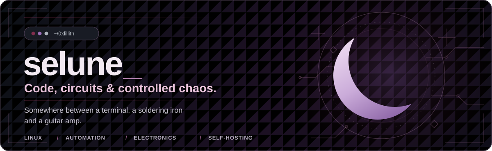

  

  
<em>I build things, break things and learn things.</em>

---

Hey, I'm **selune** (aka `0xlillith`, she/her). I'm a curious maker somewhere between **software, hardware and systems**. I like getting to know how things work, dismantling problems, and building useful (occasionally chaotic) solutions.

### Where I spend my time

| | |
| :-- | :-- |
| **Linux & self-hosting** | Containers, services, networking, storage and homelab experiments. |
| **Automation & tooling** | Python, shell scripting, VBA, and practical workflows that save time. |
| **Electronics & making** | Soldering, hardware repair, keyboard mods, 3D printing and prototyping. |
| **Open source** | Exploring codebases, learning from other maintainers and contributing thoughtfully. |

### Selected projects

- **[Viper](https://github.com/0xlillith/Viper)** — a cyberdeck build log: compact hardware, a custom keyboard, 3D-printed parts and endless tinkering.
- **[Snap / Tidbit case mod](https://github.com/0xlillith/Snap-Tidbit_casemod)** — custom enclosure ideas for the Nullbits keyboard ecosystem.
- **[Snap keymap](https://github.com/0xlillith/0xlillith_snap_keymap)** — mechanical keyboard firmware and layout customization.
- **[dotfiles](https://github.com/0xlillith/dotfiles)** — bits and pieces of my computing environment.

### On my workbench

- **[SolveCraft](https://github.com/bherbruck/solvecraft)** — exploring parametric CAD in Rust, with a [fork](https://github.com/0xlillith/solvecraft) and a first contribution in preparation.
- **Local AI & developer tooling** — experimenting with local models, agents and reproducible development workflows.
- **Homelab** — keeping my self-hosted services useful, understandable and reasonably well-behaved.
- **Electronics** — practicing fine-pitch soldering and BGA rework, one pad at a time.

---

Build it. Break it. Understand it. Build it better.

