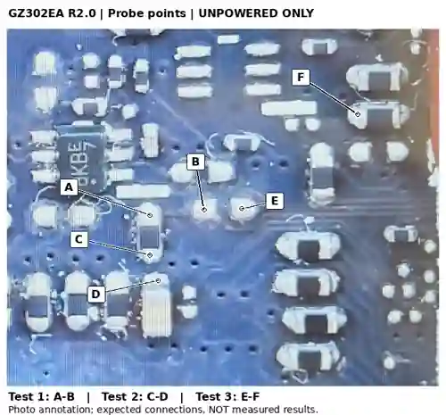

# ASUS ROG Flow Z13 GZ302EA — memory straps and 128 GB research

Updated: 2026-11-01. Board covered: **GZ302EA R2.0**.

**Current status: all three pre-rework multimeter checks passed with direct continuity, as reported by the owner. Original DRAM and straps remain unchanged at the last explicit hardware-state report; no rework or 128 GB boot result has been reported.** Numerical resistance readings were not supplied. [Measurement record](docs/multimeter-checks.md).

The planned upgrade uses **eight Samsung `K3KLALA0DM-MGCU` packages**. From the factory 32 GB Samsung configuration, the documented strap change is **`R0715 → R0744`**, selecting `0110 → 1110`. Leave `R0726`, `R0728` and `R0705` unchanged. Changing straps alone does not add RAM.

The physical PCB marking is **R2.0**, despite SMBIOS reporting `Version 1.0`. Do not apply these physical designators to a genuine R1.0 PCB without checking that revision. [Evidence and sources](SOURCES.md).

## Evidence status

- **Re-read from the original BoardView:** resistor pairs, nets, pad coordinates, board sides and the reference BOM. File hash recorded below.
- **Owner-reported physical tests:** T1/T2/T3 passed with direct continuity. This supports the identified connections on the actual board; Ω readings and instrument metadata were not supplied. [S8](SOURCES.md#s8--owners-continuity-test-report).
- **Recovered project result:** the nine-row BIOS/APCB selection table. Its original firmware version, hash and extraction offsets have not yet been recovered; this publication is not a fresh binary analysis.
- **Not demonstrated:** a completed strap/DRAM replacement, successful training/POST with the replacement chips, or long-term stability. Existing firmware support is a working expectation, not a guarantee.

## Strap pairs — two board faces

`1` = pull-up to `+1.8VS`; `0` = pull-down to `GND`. Bit strings are written **SEL3 first, SEL0 last**.

| Bit | `0` / GND | `1` / +1.8VS | BoardView face | Factory Samsung 32 GB |
|---|---|---|---|---|
| SEL3 | `R0715` | `R0744` | BOTTOM — photographed APU/DRAM face | R0715 |
| SEL2 | `R0719` | `R0726` | BOTTOM — photographed APU/DRAM face | R0726 |
| SEL1 | `R0727` | `R0728` | TOP — opposite face | R0728 |
| SEL0 | `R0705` | `R0739` | TOP — opposite face | R0705 |

The populated straps in the reference BOM are **10 kΩ, 0402, 1/16 W, 5%, TA-I `RM04JTN103`**. The alternate footprints are `Nobom`. For these documented configurations, populate **one resistor per pair**, not both or neither. Do not substitute a wire bridge.

## Complete DRAM / APCB / strap table

| Total | Manufacturer | LPDDR5X part number | Per package ×8 | APCB | BoardMask | SEL3..0 | SEL3 / BOTTOM | SEL2 / BOTTOM | SEL1 / TOP | SEL0 / TOP |
|---:|---|---|---:|---:|---|:---:|---|---|---|---|
| 64 GB | SK hynix | `H58G66CK8BX147N` | 8 GB | 1 | `0x0002` | `0000` | `R0715` ↓ | `R0719` ↓ | `R0727` ↓ | `R0705` ↓ |
| 64 GB | Samsung | `K3KL9L90DM-MGCU` | 8 GB | 2 | `0x0004` | `0001` | `R0715` ↓ | `R0719` ↓ | `R0727` ↓ | `R0739` ↑ |
| 64 GB | Micron | `MT62F2G32D4DS-023 WT` | 8 GB | 3 | `0x0008` | `0011` | `R0715` ↓ | `R0719` ↓ | `R0728` ↑ | `R0739` ↑ |
| 32 GB | SK hynix | `H58G56CK8BX146N` | 4 GB | 4 | `0x0010` | `0100` | `R0715` ↓ | `R0726` ↑ | `R0727` ↓ | `R0705` ↓ |
| 32 GB | Samsung | `K3KL8L80DM-MGCU` | 4 GB | 5 | `0x0020` | `0110` | `R0715` ↓ | `R0726` ↑ | `R0728` ↑ | `R0705` ↓ |
| 32 GB | Micron | `MT62F1G32D2DS-023 WT` | 4 GB | 6 | `0x0040` | `0111` | `R0715` ↓ | `R0726` ↑ | `R0728` ↑ | `R0739` ↑ |
| 128 GB | SK hynix | `H58G78CK8BX185N` | 16 GB | 7 | `0x0080` | `1100` | `R0744` ↑ | `R0726` ↑ | `R0727` ↓ | `R0705` ↓ |
| 128 GB | Samsung | `K3KLALA0DM-MGCU` | 16 GB | 8 | `0x0100` | `1110` | `R0744` ↑ | `R0726` ↑ | `R0728` ↑ | `R0705` ↓ |
| 128 GB | Micron | `MT62F4G32D8DV-023 WT` | 16 GB | 9 | `0x0200` | `1111` | `R0744` ↑ | `R0726` ↑ | `R0728` ↑ | `R0739` ↑ |

↑ = pull-up; ↓ = pull-down. Each row lists the **four final populated positions**, not extra parts to add. The seven unlisted four-bit codes have no documented configuration here; do not extrapolate them.

`BoardMask` is **not the binary strap value**. In this recovered table it equals `1 << APCB instance`; for example `0110` is associated with instance 5 and mask `0x0020`, not mask `0x0006`. This is an observed correspondence, not a general firmware rule.

## Samsung 32 GB → 128 GB

| | Factory | Target |
|---|---|---|
| DRAM | 8 × `K3KL8L80DM-MGCU` | 8 × `K3KLALA0DM-MGCU` |
| Total | 32 GB | 128 GB |
| SEL3..0 | `0110` | `1110` |
| R0715 | 10 kΩ fitted | Empty |
| R0744 | Empty | Same 10 kΩ resistor fitted |
| R0726 / R0728 / R0705 | Fitted | Unchanged |

In the corrected microscope view, **R0715 is vertical; R0744 is the empty horizontal footprint above-right**. Rotate the resistor 90° to fit the destination; it is not polarised. **R2848 is the separate empty footprint above R0744 and must not be used.**

[BoardView-derived region and orientation](docs/boardview.md) · [Other configurations](docs/other-configurations.md)

## Check before removing anything



The labels correspond to metal contact points on the original photograph, not reconstructed components. Measure only with battery, charger and powered peripherals disconnected and the board de-energised.

| Test | Red lead | Black lead | Shared net | Expected result |
|---|---|---|---|---|
| 1: A–B | R0715 pad 2, upper end | R0744 pad 1, left pad | `DIMM_SEL3` | Direct continuity; low, stable Ω near the shorted-lead reference |
| 2: C–D | R0715 pad 1, lower end | C0704 pad 2, upper end | `GND` | Same |
| 3: E–F | R0744 pad 2, right pad | R0726 pad 2, left end | `+1.8VS` | Same |

**Recorded result: T1, T2 and T3 PASS — direct continuity reported by the owner.** Numerical Ω values remain unreported. This supports the pad identification, but is not a complete short-circuit or post-rework test. `+1.8VS` names a net; this is not a request to apply power or measure 1.8 V. C0704's other terminal is `+1.8VSUS`, a different net. Stop on any unresolved discrepancy. [Full procedure and measurement log](docs/multimeter-checks.md).

## Project notes

| Document | Contents |
|---|---|
| [STATE](STATE.md) | Current hardware state and next gates |
| [BoardView](docs/boardview.md) | Both faces, original pad coordinates, orientation and nearby parts |
| [Multimeter](docs/multimeter-checks.md) | Exact probe placement, expected readings and owner-reported results |
| [All configurations](docs/other-configurations.md) | Moves from factory Samsung 32 GB, separated by face |
| [Hardware and firmware](docs/hardware-firmware.md) | Baseline, package evidence, APCB limitations |
| [Rework and materials](docs/rework.md) | Equipment, practice incident, process controls and test plan |
| [Procurement](docs/procurement.md) | Recorded purchases, historical prices, missing quotations |
| [Corrections](CORRECTIONS.md) | Withdrawn illustrations and corrected claims |
| [Sources](SOURCES.md) | Provenance and unavailable evidence |
| [Agent instructions](AGENTS.md) | Rules for maintaining this documentation |

## Reproducibility

Original file: `GZ302EA Rev 2.0 BoardView .fz` — **not redistributed**.

```text
SHA-256: b87c91f10ef4163c7129db8a7e1eedea4f2d148d829fb911e5b05c15f6824944
```

Machine-readable [strap extract](data/boardview-extract.json), [configuration table](data/configurations.json) and [probe checks](data/probe-checks.json) accompany the notes. Run `python3 scripts/check_reference.py` to verify their internal consistency. This does not test hardware or re-analyse the BIOS.

This is experimental board-level rework documentation, not a completed-upgrade report. Incorrect parts, identification or heating can damage the board. The original commercial BoardView, firmware binaries, private supplier messages and withdrawn generated illustrations are excluded.
