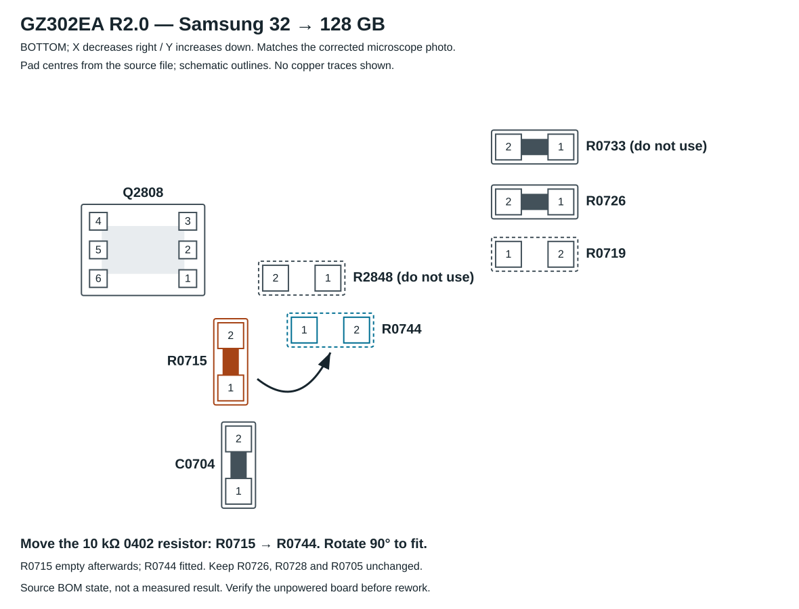

# BoardView region, faces and pad coordinates

Source: `GZ302EA Rev 2.0 BoardView .fz`, read again on 2026-10-31.

```text
SHA-256 b87c91f10ef4163c7129db8a7e1eedea4f2d148d829fb911e5b05c15f6824944
```

The original FZ file is not included. The small coordinate/net extract records the facts used for this mod. It is not a complete schematic or a board reconstruction.

## Correct orientation

In the owner's overall photograph with the row of four DRAM packages at the bottom, the strap region is **above the upper-left DRAM package, below the upper-left APU mounting hole and beside the APU's upper-left corner**. An earlier guide incorrectly sent the owner to the upper-right region; that guide is withdrawn.

The source's native X axis runs in the opposite direction to the corrected BOTTOM photograph. For a local plot that matches this photograph, use **X decreasing to the right and Y increasing down**. This is a view convention, not a change to stored coordinates. Do not infer the displayed location from the word BOTTOM alone.



The vector diagram uses actual pad centres with schematic component outlines. It is **not a BoardViewer screenshot** and shows no copper traces. Dotted outlines indicate BOM-unpopulated footprints, not a measured state.

## The two faces

The FZ `SYM_MIRROR` field assigns `YES` to R0715/R0744/R0726/R0719 and `NO` to R0727/R0728/R0705/R0739. OpenBoardView interprets those as BOTTOM and TOP respectively. BOTTOM is the APU/DRAM face in the owner's photographs. SEL1/SEL0 must not be overlaid onto components visible on this face. [Reader reference](https://github.com/OpenBoardView/OpenBoardView/blob/master/src/openboardview/FileFormats/FZFile.cpp).

## Nearby parts that must not be confused

| Part | Function in the source | Identification note |
|---|---|---|
| R0715 | SEL3 pull-down | Mounted, vertical; 10 kΩ in BOM |
| R0744 | SEL3 pull-up | Empty horizontal destination, above-right of R0715 in corrected photo |
| R2848 | SPI-related footprint | Empty horizontal footprint above R0744; not a memory strap |
| C0704 | 10 µF capacitor | Below R0715; upper pad is GND, lower pad is +1.8VSUS |
| R0726 | SEL2 pull-up | Second of the two mounted horizontal resistors at upper right |
| R0719 | SEL2 pull-down | Empty pair below R0726 |
| R0733 | AGPIO9 / TPANEL_INT# | Mounted horizontal resistor above R0726; not a strap |
| Q2808 | ROHM EM6K1GT2R dual N-MOSFET | Six-pin reference component to the left of R0715 in the corrected photo |

## Original coordinates

Unmodified source coordinates, in mils. Pad numbers are identifiers, not polarity markings for the resistor.

| Part | Face | Pad | X (mils) | Y (mils) | Net |
|---|---|---:|---:|---:|---|
| R0715 | BOTTOM | 1 | 7687.8 | 2443.9 | `GND` |
| R0715 | BOTTOM | 2 | 7687.8 | 2407.9 | `DIMM_SEL3` |
| R0744 | BOTTOM | 1 | 7637.3 | 2404.1 | `DIMM_SEL3` |
| R0744 | BOTTOM | 2 | 7601.3 | 2404.1 | `+1.8VS` |
| R0726 | BOTTOM | 1 | 7461 | 2316 | `DIMM_SEL2` |
| R0726 | BOTTOM | 2 | 7497 | 2316 | `+1.8VS` |
| R0719 | BOTTOM | 1 | 7497 | 2352 | `GND` |
| R0719 | BOTTOM | 2 | 7461 | 2352 | `DIMM_SEL2` |
| R0728 | TOP | 1 | 7452 | 2282 | `DIMM_SEL1` |
| R0728 | TOP | 2 | 7488 | 2282 | `+1.8VS` |
| R0727 | TOP | 1 | 7488 | 2324 | `GND` |
| R0727 | TOP | 2 | 7452 | 2324 | `DIMM_SEL1` |
| R0739 | TOP | 1 | 7452 | 2210 | `DIMM_SEL0` |
| R0739 | TOP | 2 | 7488 | 2210 | `+1.8VS` |
| R0705 | TOP | 1 | 7452 | 2246 | `GND` |
| R0705 | TOP | 2 | 7488 | 2246 | `DIMM_SEL0` |
| C0704 | BOTTOM | 1 | 7682.4 | 2514.9 | `+1.8VSUS` |
| C0704 | BOTTOM | 2 | 7682.4 | 2478.9 | `GND` |
| R2848 | BOTTOM | 1 | 7621 | 2368.4 | `APU_SPI_WP#_R` |
| R2848 | BOTTOM | 2 | 7657 | 2368.4 | `SPI_FLASH_IO2` |
| R0733 | BOTTOM | 1 | 7461 | 2278.27 | `AGPIO9` |
| R0733 | BOTTOM | 2 | 7497 | 2278.27 | `TPANEL_INT#` |

## BOM scope

R0715, R0726, R0728 and R0705 are populated in the reference BOM as `TA-I RM04JTN103`, 10 kΩ, 0402, 1/16 W, 5%. R0744, R0719, R0727 and R0739 are `Nobom//Nobom`. This is design/BOM information; the final physical population must be inspected.

Source: [S1](../SOURCES.md). Cross-check the nets on the actual unpowered board using the [multimeter procedure](multimeter-checks.md).
