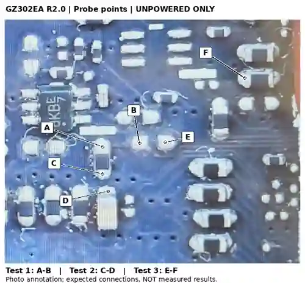

# Unpowered continuity checks before the Samsung strap change

Status: **not performed / no readings supplied**. These checks verify connections expected from the BoardView; they do not certify the upgrade.

## Preparation

Disconnect the battery, charger, USB devices and other powered connections. The board must be de-energised before continuity/resistance measurements. Use the meter's instructions to confirm residual voltage has fallen safely; do not discharge components by shorting them. Black lead goes in COM; red lead goes in V/Ω, not A/mA. Select continuity or resistance. Record the reading with the probe tips touching before probing the board. Use fine tips under magnification without scraping or bridging adjacent pads. General meter safety: [Fluke](https://www.fluke.com/en/learn/blog/maintenance-monitoring/how-to-use-a-multimeter-guide).

All directions below refer to the photograph above. Do not reuse them after rotating or mirroring an image.

## Contact points

| Label | Reference | Pad | In this photograph | BoardView net |
|---|---|---:|---|---|
| A | R0715 | 2 | Upper end of the mounted vertical resistor | `DIMM_SEL3` |
| B | R0744 | 1 | Left pad of the empty horizontal destination | `DIMM_SEL3` |
| C | R0715 | 1 | Lower end of that same mounted resistor | `GND` |
| D | C0704 | 2 | Upper end of the capacitor below R0715 | `GND` |
| E | R0744 | 2 | Right pad of the empty horizontal destination | `+1.8VS` |
| F | R0726 | 2 | Left end of the second mounted horizontal resistor at upper right | `+1.8VS` |

The horizontal resistor above R0726 is **R0733**, not another strap. The empty horizontal footprint above R0744 is **R2848**, not the destination. C0704 is a capacitor: its **upper pad 2 is GND**, while its lower pad 1 is **+1.8VSUS**, not +1.8VS. Do not substitute the screw ring as a ground reference without verifying it.

## Three measurements

| Test | Red | Black | Expected |
|---|---|---|---|
| T1 — SEL3 connection | A | B | Low, stable resistance close to the shorted-lead reading |
| T2 — ground connection | C | D | Same |
| T3 — pull-up rail connection | E | F | Same |

These are same-net checks. **10 kΩ is not the expected reading**: none measures across both ends of R0715. The name `+1.8VS` is not an expected voltage during this procedure; do not power the board for T3.

Use the numerical resistance reading as well as the beeper. There is no universal beeper threshold or fixed acceptance value specified here. If a result is OL, kiloohms, unstable, or materially above the shorted-lead reference, check tip contact, mode and component identification. Do not desolder until the discrepancy is resolved.

Passing these three checks supports the pad identification, but is not a complete short-circuit test: a fault shorting nets together could also produce continuity. It does not isolate the resistor's value, prove every rail is healthy, validate the DRAM part, or establish BIOS compatibility. Those are separate checks.

## Record actual results

Do not fill this table with expected readings.

| Field | Recorded value |
|---|---|
| Date / operator | Not recorded |
| Meter model and mode | Not recorded |
| Battery / charger / powered peripherals disconnected | Not recorded |
| Residual voltage check | Not recorded |
| Shorted-lead reference, Ω | Not measured |
| T1 A–B, Ω | Not measured |
| T2 C–D, Ω | Not measured |
| T3 E–F, Ω | Not measured |
| Any discrepancy / corrective action | Not recorded |
| Decision to proceed | Pending |

Update this table and [probe-checks.json](../data/probe-checks.json) together when measurements are supplied. The source records include original photo coordinates and BoardView coordinates; a label in this image is not a measurement.

## After the eventual move

The copper connections tested above do not change when the resistor is moved, so passing them again does **not** prove that the new resistor was soldered correctly. Inspect both solder joints at R0744 and confirm R0715 is empty. Check for bridges and displaced adjacent parts. An in-circuit resistance reading may be affected by other paths and is not automatically an isolated 10 kΩ measurement.

Source: [S1, S2 and S5](../SOURCES.md). No physical continuity or resistance readings have yet been recorded.
